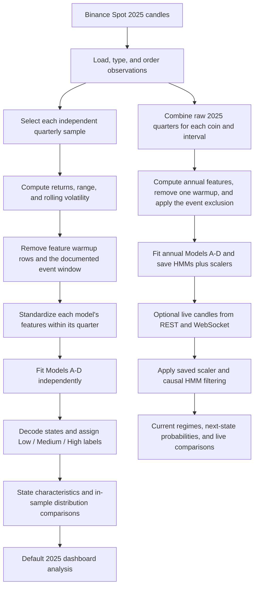

# Complete system summary for the thesis

Prepared from the current implementation and local artifacts on **25 October 2026**.

This document explains what we implemented, how the data move through the system, what the dashboard shows, and how to divide the work into thesis sections. It describes the final system rather than every intermediate design. Detailed numerical profiles are in [MODEL_GUIDE.md](MODEL_GUIDE.md).

## 1. The study in one paragraph

We developed a cryptocurrency volatility-regime analysis system using three-state Gaussian Hidden Markov Models. The study uses Binance Spot candle data for Bitcoin, Ethereum, Dogecoin, and Litecoin at 5-minute, 15-minute, and 30-minute intervals during the stored 2025 calendar year. Four feature combinations compare a baseline of absolute logarithmic return and normalized high-low price range with combinations that add trading volume, rolling volatility, or both. Models are fitted independently by quarter for historical analysis, while separate models trained on the combined 2025 data are saved for optional live inference. The system describes Low, Medium, and High volatility states, compares state assignments and model-implied next-state distributions, and presents the results on synchronized price-line charts. Distribution comparisons quantify agreement with baseline Model A; they do not establish predictive accuracy.

## 2. How to divide the explanation into parts

| Part | Topic to explain | Main output |
| --- | --- | --- |
| A | Research scope and questions | Coins, intervals, year, baseline, and comparison objectives. |
| B | Data acquisition and organization | Raw Binance candle files, divided by coin, interval, and quarter. |
| C | Data preparation and sample definition | Typed, ordered observations with usable features and documented exclusions. |
| D | Feature engineering and standardization | The input matrices for Models A-D. |
| E | HMM specification and training | State distributions, covariances, initial probabilities, and transition probabilities. |
| F | Regime labeling and state characteristics | Interpretable Low/Medium/High labels and numerical profiles. |
| G | Historical 2025 analysis | Independent quarterly fits and descriptive comparisons across the year. |
| H | Saved models and optional live inference | Reusable annual models, current-state probabilities, and next-state probabilities. |
| I | Model comparison and ranking | Agreement, overlap, JSD, directional KL, Top-1 agreement, and comparison counts. |
| J | Dashboard presentation | Four synchronized price charts, comparison tables, and the log-likelihood view. |
| K | Validation, limitations, and interpretation | Evidence that calculations work and boundaries on the thesis claims. |

The sections below expand these parts. Different members can explain different parts while following the same data flow and definitions.

## 3. Research scope and SOP alignment

The scope is four USDT trading pairs: **BTCUSDT, ETHUSDT, DOGEUSDT, and LTCUSDT**. Each is analyzed at **5m, 15m, and 30m**. The historical dataset is divided into **Q1, Q2, Q3, and Q4 of 2025**.

The current research questions are:

1. What are the characteristics of the low, medium, and high volatility regimes identified by Hidden Markov Models in Bitcoin, Ethereum, Dogecoin, and Litecoin across different trading intervals?
2. What differences can be observed between traditional indicators (log returns and high-low price range) and additional indicators (trading volume and rolling volatility) in detecting cryptocurrency volatility regimes using Hidden Markov Models?
3. What differences can be observed in the performance of different feature combinations in detecting volatility regimes across quarterly periods within the one-year dataset for Bitcoin, Ethereum, Dogecoin, and Litecoin?

In the implemented models, the direct return feature is **absolute log return**. Signed log return remains available for computing rolling volatility and describing return dispersion. The term "traditional indicators" identifies this study's baseline price features.

| SOP | How the system addresses it | Evidence to present |
| --- | --- | --- |
| 1: Regime characteristics | Describes the observations assigned to each state. | Feature statistics, state proportions, duration, persistence, and transition behavior by coin and interval. |
| 2: Feature comparison | Compares A with B, C, and D while keeping the common price-feature definitions and three-state structure consistent. | Reclassified candles, state profiles, agreement, and next-state distribution comparisons with A. |
| 3: Quarterly differences | Fits each quarter independently and compares the resulting state characteristics and model agreement. | Quarter-specific tables, year-long charts with quarter boundaries, and comparison metrics using explicitly stated date windows. |

"Performance" must be defined according to the measure being reported. Agreement with A, separation between states, persistence, and predictive accuracy are different evaluation targets.

## 4. End-to-end workflow



Quarterly and annual training are separate procedures. The historical year view combines results from independent quarterly fits. The optional live view applies one saved annual model per feature combination.

## 5. Part B: Getting and organizing the data

### 5.1 Source and collection

We used Binance Spot's public kline endpoint to obtain historical OHLCV candles. The fetcher requests one coin, interval, and quarter at a time. It retrieves up to 1,000 candles per request, advances the starting timestamp after the last returned candle, and continues until the requested period is covered or data retrieval stops. It includes request retries and short pauses between requests.

The raw kline fields include opening time, open, high, low, close, volume, closing time, quote-asset volume, trade count, and taker-buy fields. The analysis uses the price, time, and volume fields needed for its features; storing a field does not automatically make it an HMM input.

The `volume` field is the quantity of the **base cryptocurrency traded during the candle**. For BTCUSDT it is BTC, for ETHUSDT it is ETH, and similarly for DOGE and LTC. The separate quote-asset volume field represents USDT turnover and is not the volume input used by B and D.

### 5.2 Storage and file count

The active historical inputs are in `src/HMM/data/raw/`, with names such as:

```text
btc_15m_Q1_2025.json
eth_5m_Q3_2025.json
doge_30m_Q4_2025.json
ltc_15m_Q2_2025.json
```

There are **48 raw files**: `4 coins x 3 intervals x 4 quarters`. These are 48 data partitions, rather than 48 trained models. The separate top-level `data/raw/` directory is not the active source used by the current batch runner and dashboard backend.

### 5.3 Verified coverage

The following raw counts apply **to each coin**:

| Interval | Q1 | Q2 | Q3 | Q4 | Whole stored year |
| --- | ---: | ---: | ---: | ---: | ---: |
| 5m | 25,920 | 26,208 | 26,496 | 26,496 | 105,120 |
| 15m | 8,640 | 8,736 | 8,832 | 8,832 | 35,040 |
| 30m | 4,320 | 4,368 | 4,416 | 4,416 | 17,520 |

The complete raw collection contains **630,720 candles** across all four coins and all three intervals. Each interval is a separate series; these overlapping aggregations are not independent observations of different markets. The local coverage audit found unique timestamps and consecutive interval spacing within each of the 12 coin/interval series.

The stored year follows **UTC+8 calendar boundaries**: `2024-12-31 16:00 UTC` inclusive to `2025-12-31 16:00 UTC` exclusive. The dashboard displays dates in UTC. The fetcher constructs local, timezone-naive calendar dates before converting them to epoch timestamps, so reproducing collection on a computer in another timezone can change the period boundaries. State the stored timezone convention in the thesis.

**Code:** [data_fetcher.py](src/HMM/data_fetcher.py).

## 6. Part C: Loading, preparation, and exclusions

We load the JSON candles into pandas DataFrames, convert numeric strings into numeric columns, convert timestamps for analysis, and sort the observations chronologically. The annual training loader concatenates quarterly files and removes duplicate timestamps. The live-data converter also sorts and removes duplicates. The modular batch loader sorts its source data; the current raw-file audit supplies the evidence that those stored inputs contain no duplicate timestamps.

Derived features are calculated in time order. Rows without sufficient return history are removed. A ten-return rolling standard deviation requires ten returns, so the first **ten raw candles** do not enter the fitted feature matrix. This preparation is applied consistently across A-D, including A and B, because rolling volatility is needed for labeling every model's states.

We also apply the existing event-window exclusion from **10 October 2025 at 20:00 UTC through 11 October 2025 at 04:00 UTC, inclusive**. It was introduced to address fits whose hidden states collapsed around extreme observations. The window removes 97 bars at 5m, 33 at 15m, or 17 at 30m per coin. Feature derivation precedes this exclusion, so following rolling windows can still contain returns from inside the removed interval.

| Interval | Raw candles per coin/year | Usable annual training rows | Sum of usable quarterly rows |
| --- | ---: | ---: | ---: |
| 5m | 105,120 | 105,013 | 104,983 |
| 15m | 35,040 | 34,997 | 34,967 |
| 30m | 17,520 | 17,493 | 17,463 |

Annual training loses ten warmup rows once after concatenating the year. Independent quarterly fitting loses ten at the beginning of each quarter. This explains the difference between the last two columns.

These are documented sample exclusions, not removal of every high-volatility observation. They also limit what the study can conclude about the excluded extreme-event period. HMM training treats retained rows across that gap as adjacent in its input sequence; observed duration and switching summaries explicitly break at missing candle intervals.

**Code:** [data_loader.py](src/HMM/data_loader.py), [feature_engineering.py](src/HMM/feature_engineering.py), and `load_file()`, `base_features()`, and `drop_excluded()` in [server.py](src/HMM/server.py).

## 7. Part D: Feature engineering

Let `C[t]`, `H[t]`, and `L[t]` denote the candle's close, high, and low prices.

| Variable | Computation | Meaning and use |
| --- | --- | --- |
| Signed log return | `r[t] = ln(C[t] / C[t-1])` | Records movement direction and magnitude. Used to calculate rolling volatility and descriptive return dispersion. |
| Absolute log return | `a[t] = abs(r[t])` | Measures close-to-close movement magnitude. This is the direct return input in all four HMMs. |
| Normalized high-low range | `h[t] = (H[t] - L[t]) / C[t]` | Describes price movement within the candle relative to its close. Used in all four HMMs. |
| Trading volume | Raw candle `volume` field | Describes trading activity in base-asset units. Used in B and D after standardization. |
| Rolling volatility | Sample standard deviation of `r[t-9], ..., r[t]` | Describes recent return variation. Used as an input in C and D, and as the labeling measure for every model. |

The rolling calculation uses a window mean and divides the sum of squared deviations by **9**, corresponding to the pandas sample-standard-deviation default, `ddof=1`. The ten-return window covers 50 minutes at 5m, 150 minutes at 15m, and 300 minutes at 30m.

Taking the absolute value of the direct return input makes equal-magnitude positive and negative log returns identical for that feature. Rolling volatility still uses **signed** returns. The system's Low/Medium/High labels describe volatility rather than bull, bear, or sideways price direction.

We retained raw volume as the feature definition and standardized it before fitting. We did not implement logarithmic volume, volume change, or volume surprise as the B/D inputs. A separate exploratory volume-analysis script does not change the active HMM features.

## 8. Standardizing the inputs

Each input feature is standardized independently:

```text
z[t, feature] = (original value - training feature mean) / training feature standard deviation
```

The scaler's mean and standard deviation come from all usable rows in the relevant training sample. StandardScaler uses the population standard deviation for scaling (`ddof=0`), which differs from the sample standard deviation used in the ten-return rolling feature.

For an illustrative example, if training volume has mean 100 BTC and standard deviation 50 BTC, a candle with 200 BTC becomes `(200 - 100) / 50 = 2`. This means two standard deviations above the training mean. A negative standardized volume indicates below-average activity; its original volume can remain positive.

Quarterly models have scalers fitted within their own coin, interval, quarter, and feature set. Annual saved models have scalers fitted on their coin/interval's combined 2025 sample. Later live candles use the saved annual scaler without recalculating its mean or standard deviation from the live window.

Standardization changes the numerical scale of model inputs. It does not change the actual price line displayed on the dashboard, impose a manually selected volume weight, or guarantee Gaussian feature distributions.

**Code:** `build_features_A()` through `build_features_D()` in [feature_engineering.py](src/HMM/feature_engineering.py), and `MODEL_COLUMNS`, `MODELS`, and `train_2025_models()` in [server.py](src/HMM/server.py).

## 9. Part E: The four models and HMM training

### 9.1 Feature combinations

| Model | Inputs | Dimensions | Role |
| --- | --- | ---: | --- |
| A | Absolute log return + normalized high-low range | 2 | Baseline price-feature model. |
| B | A's inputs + trading volume | 3 | Examines the effect associated with adding volume. |
| C | A's inputs + rolling volatility | 3 | Examines the effect associated with adding recent return variation. |
| D | A's inputs + volume + rolling volatility | 4 | Examines both additions together. |

The controlled comparisons are A-B and C-D for adding volume, and A-C and B-D for adding rolling volatility. The dashboard's baseline-agreement table displays A-B, A-C, and A-D.

All four models use **three-state Gaussian HMMs with full covariance**. Full covariance allows feature relationships within a state, such as the relationship between trading activity and price range. Model B is not the only model with covariance; A, C, and D also have full state covariance matrices.

### 9.2 What the HMM learns

The model learns:

1. An initial-state probability distribution.
2. A mean feature vector for each state.
3. A covariance matrix for each state.
4. A transition matrix describing state-to-state probabilities.

Training uses the GaussianHMM fitting procedure in hmmlearn, based on expectation-maximization. The states are latent; raw candle files do not supply known Low/Medium/High labels. The number of states is fixed at three before fitting. This study characterizes that three-state design rather than demonstrating that three is the optimal state count.

Quarterly fitting allows up to **500 iterations**, using seed **42**. Annual saved-model fitting allows up to **100 iterations**, uses tolerance **0.01**, and tries seeds **42, 7, and 2025** until it obtains a fit with acceptable state occupancy. These are maximum iteration counts, not evidence that every fit took exactly that many iterations. The fallback seeds are not a completed repeated-initialization stability experiment.

Fits are screened using a minimum state occupancy of **1%**. Failed or degenerate fits remain explicit errors; their chart assignments are gaps. Passing this screen establishes enough occupancy under that rule, rather than proving three well-separated natural market regimes.

**Code:** [hmm_model.py](src/HMM/hmm_model.py), `run_hmm()` and `train_2025_models()` in [server.py](src/HMM/server.py).

## 10. Part F: Naming and characterizing the regimes

Hidden state numbers 0, 1, and 2 are arbitrary. For training descriptions and the historical quarterly state traces, we decode a Viterbi state sequence. We then calculate mean rolling volatility for the training observations assigned to each state and order the states:

```text
Lowest mean rolling volatility   -> Low volatility
Middle mean rolling volatility   -> Medium volatility
Highest mean rolling volatility  -> High volatility
```

This mapping makes independently fitted models interpretable and allows probability vectors to be aligned consistently as **Low / Medium / High**. Comparing raw hidden-state IDs across models would be incorrect.

The labels are relative to the fitted sample. There is no universal numerical threshold shared by every coin, interval, quarter, and model. A High regime in a quiet quarter can have lower absolute volatility than a Medium regime in a more volatile quarter.

For state characteristics, we calculate count, proportion, mean, median, standard deviation, and first/third quartiles for signed return, absolute return, range, volume, and rolling volatility. We also describe consecutive run lengths, median run duration in minutes, switching rates, and learned self-transition probabilities. Every feature can be described within every model's states, including a feature that was not an input to that model.

These empirical profiles group candles by decoded states. They are distinct from the Gaussian means learned using probabilistic state weights during fitting. Ordering by mean rolling volatility guarantees its label order; a fuller interpretation also examines the other features and distribution overlap.

**Code:** `label_regimes()` in [hmm_model.py](src/HMM/hmm_model.py), [regime_statistics.py](src/HMM/regime_statistics.py), and the stored state mappings in annual bundles.

## 11. Part G: Quarterly 2025 analysis and exported outputs

For every coin, interval, and quarter, Models A-D are fitted independently:

```text
4 coins x 3 intervals x 4 quarters x 4 models = 192 quarterly fits
```

The current processed summary records **192 successful fits**, with 48 entries per coin. There are 192 corresponding candle-level JSON files. These files retain actual OHLCV values, signed and absolute returns, range, rolling volatility, hidden-state numbers, and volatility labels.

The batch runner exports files to `src/HMM/data/processed/`. BTC keeps filenames such as `hmm_15m_Q1_ModelA.json`. The other coins have prefixes, such as `hmm_eth_15m_Q1_ModelA.json`, to keep their results separate. The combined `hmm_results_summary.json` includes the coin, interval, quarter, model, fit scores, state profiles, state proportions, run lengths, transitions, and fit status.

The dashboard's `/api/run` endpoint also fits quarterly models for the selected coin and interval, then stitches the results into date order. Therefore, one historical dashboard selection covers **16 quarterly fits**: four models for each of four quarters. Dashed quarter markers indicate new independent fits, not a single HMM trained continuously through all four quarters.

### 11.1 Why 2025 now shows overlap, JSD, KL, and Top-1

For each already-fitted quarterly model, we forward-filter its standardized observations and multiply the current filtered state probabilities by its transition matrix. We compare the resulting model-implied next-state distributions across A-B, A-C, and A-D. This reuses the same fitted models used for the historical chart.

The 2025 comparison is explicitly **in-sample**: the parameters, scaler, and state-label mapping were obtained from that entire quarter. It describes how the fitted models differ. It does not represent forecasts made in 2025 using parameters known before each displayed candle. Its count is labeled **Compared candles**.

The API stores these dynamic values under `distribution_comparison`, with `method = in_sample_quarter_fit`, `is_out_of_sample = false`, and `past_only_forecasts_available = false`. Live forecasts use a separate field and calculation path.

The dynamic overlap/JSD/KL/Top-1 tables are returned by the dashboard APIs and summarized for the selected chart window. They are not automatically added to the batch's processed summary or exported to a new CSV. Record the selected coin, interval, exact UTC window, and mode when using a dashboard table in the thesis.

**Code:** [main.py](src/HMM/main.py), [export_to_json.py](src/HMM/export_to_json.py), and `run_hmm()` / `/api/run` in [server.py](src/HMM/server.py).

## 12. Part H: Saving annual models and optional live inference

### 12.1 What was saved

We separately combined each coin/interval's 2025 quarter files and trained Models A-D on that full-year sample:

```text
4 coins x 3 intervals x 4 models = 48 saved annual bundles
```

Each `.joblib` bundle contains its fitted HMM, scaler, feature list, hidden-state-to-volatility mapping, state-average 2025 rolling volatility, training row count, training date bounds, occupancy, coin, interval, model identifier, and model version. Bundles are stored in `src/HMM/data/models/2025/` and are locally generated artifacts.

The server checks the model version and feature columns when loading a bundle and uses its file modification time to refresh the model cache. An intentional refit is available with `--force`. Raw-data or modeling changes that require new fitting should be followed by an explicit refresh of the relevant saved models.

These annual fits are separate from the 192 quarterly outputs. A quarterly state assignment and a live assignment can differ because their training samples and decoding procedures differ.

### 12.2 How live data are handled

Live market is optional. Selecting it obtains approximately the latest 30 days of Binance Spot candles, with extra history for feature warmup, then connects to the selected coin/interval's WebSocket stream. Prices and the open candle update as stream messages arrive. The 5m, 15m, and 30m choices specify candle duration; they do not imply that the display must wait until a candle closes before updating.

The saved scaler transforms incoming features. Forward filtering calculates state probabilities using only observations available through the current candle, and the most likely filtered state determines its live regime color. The next-state calculation is:

```text
next hidden-state probabilities = current filtered probabilities x transition matrix
```

The next-state vector is reordered using the saved Low/Medium/High mapping. It estimates the regime for the next selected candle interval. It is not a forecast of the next closing price.

Streaming updates carry the last closed-candle filtered state, together with a signature of the fitted model and scaler. This preserves filtering history when the browser sends a rolling buffer of recent bars and avoids repeatedly treating an open candle as a new closed observation. Model changes or an unusable context require a fresh live load.

Live forecast comparisons only include origins after the saved training cutoff. The open candle is provisional: its price, regime, and probabilities can change. Closed-candle forecasts enter the window averages; the latest provisional comparison is displayed separately. Reconnection reloads recent history to fill missed candles. Applying saved models to live data does not continuously retrain them.

**Code:** [train_2025.py](src/HMM/train_2025.py), `train_2025_models()`, `infer_saved_models()`, `/api/live`, and `/api/live/infer` in [server.py](src/HMM/server.py), and `filter_probabilities()` in [forecast_comparison.py](src/HMM/forecast_comparison.py).

## 13. What the displayed 2025 average volatility means

For each training candle, we compute the sample standard deviation of its ten most recent signed returns. For each model and state, we average those measurements over all retained annual training candles assigned to that state:

```text
2025 state-average volatility (%)
= 100 x sum(rolling volatility of training candles in that state)
        / number of training candles in that state
```

The **ten returns** define each measurement window. The **2025 year** defines the collection of measurements being summarized. This is a mean of rolling standard deviations, which is a different calculation from taking one standard deviation of all the year's returns.

The value retains the selected candle-return scale and is not annualized. It is an empirical training-state description rather than a percentage output directly estimated as the HMM's volatility parameter. A new live candle changes its inferred state and probabilities; the stored 2025 state averages remain fixed until retraining.

For the current saved BTC 15m fits:

| Model | Low (%) | Medium (%) | High (%) |
| --- | ---: | ---: | ---: |
| A | 0.1094 | 0.2066 | 0.4005 |
| B | 0.1151 | 0.2070 | 0.3862 |
| C | 0.0981 | 0.1938 | 0.4064 |
| D | 0.1026 | 0.1980 | 0.4063 |

The measured rolling-volatility series is shared by all four models for the same coin and interval. Their state averages differ because the models assign different candles to their states.

## 14. Part I: Exactly how the models are compared

The dashboard treats A as the baseline and shows **A-B, A-C, and A-D**. The models remain independently fitted; we did not adjust volume weights or force B's states to resemble A.

### 14.1 State agreement

| Measure | Calculation and meaning |
| --- | --- |
| Same regime | Percentage of valid aligned candles with exactly the same Low, Medium, or High assignment. |
| Agreeing / compared counts | Actual matching-state count divided by the valid comparison count. Equal denominators across pairs are expected when they share the same complete timestamps. |
| All four agree | Percentage and count of candles where A, B, C, and D all assign the same regime, using only candles where all four have valid states. |
| High / non-High | Percentage where both models agree on High versus Low-or-Medium. Low versus Medium counts as agreement under this coarser comparison. |

The calculations use the full state series within the visible date window, independently of chart downsampling. Missing or failed assignments are omitted from valid comparison counts, rather than counted as matches.

### 14.2 Next-state distribution comparison

Let `p` denote A's ordered next-state probabilities and `q` the comparison model's ordered probabilities. Each vector has three entries: Low, Medium, and High.

| Metric | Formula | Interpretation |
| --- | --- | --- |
| Overlap | `100 x sum(min(p[i], q[i]))` | Shared probability mass. Higher is more similar; 100% means identical distributions. |
| Jensen-Shannon divergence | `JSD = (KL(p || m) + KL(q || m)) / 2`, with `m = (p+q)/2` | Primary divergence measure. Base-2 values range from 0 to 1; lower is more similar. We report divergence, not its square root. |
| Kullback-Leibler divergence | `KL(A || other) = sum(p[i] x log2(p[i]/q[i]))` | Directional discrepancy from A, in bits. Lower is more similar. It is unbounded and is not a percentage. |
| Top-1 agreement | Percentage of aligned origins where `argmax(p) == argmax(q)` | Whether the models select the same most likely next regime. Ties use Low, then Medium, then High order. |

The prior overlap calculation, `100 x (1 - sum(abs(p-q))/2)`, equals the probability-mass-intersection formula for normalized distributions. Its interpretation was preserved when JSD and KL were added.

Inputs must be finite, nonnegative vectors with positive mass and are normalized before comparison. Raw HMM state-index permutations are corrected using the regime mappings before comparing distributions. Both models must refer to the same origin timestamp and selected interval.

If A assigns positive probability to a state and another model assigns zero, KL is **infinite**. A term with zero probability under A contributes zero. We apply no epsilon smoothing to replace these zeros. Infinite values remain in mean and median calculations, their counts are reported, and the dashboard displays an infinity symbol. JSON uses the string `"Infinity"` to preserve a valid response. Only insignificant floating-point divergence errors are adjusted within the documented numerical tolerance.

### 14.3 Window summaries and rankings

The table reports mean overlap, mean JSD, mean KL, Top-1 agreement, and the number of comparison origins. Expanded details include median JSD, median KL, and infinite-KL counts. One infinite KL observation makes the arithmetic mean infinite; the median depends on the full ordered sample and can remain finite.

Rankings are reported independently by highest mean overlap, lowest mean JSD, lowest mean KL, and highest Top-1 agreement. They use the timestamp intersection shared by all three comparison models, so unequal data coverage does not silently determine the ranking. No weighted combined score is produced. Ties are displayed, and divergent rankings are explained according to the metrics' different definitions.

Historical 2025 counts are **Compared candles** from the fitted quarterly models. Live counts are **Forecast candles** from aligned closed origins. The separate latest live table can include the current provisional candle and always refers to the latest forecast, even when the chart is panned backward.

**Code:** [forecast_comparison.py](src/HMM/forecast_comparison.py), `modelAgreement()`, `windowForecastMetrics()`, `rankForecastMetrics()`, and `updateComparisonAgreement()` in [dashboard.html](src/HMM/dashboard.html).

## 15. Log-likelihood: what we calculated and showed

We calculate log-likelihood using `model.score(X)`, where `X` is that model's standardized feature sequence. The score combines the Gaussian state distributions, initial probabilities, and transition probabilities, summing over possible hidden-state paths. It is a whole-sequence natural-log likelihood, rather than a percentage of correct state labels.

The dashboard's **Log-Likelihood** view plots each model's fitted-quarter score across the available quarters. The score is in-sample because the same quarter was used to fit the model. Its magnitude depends on the observations, their scaling, the features, and sample length.

A, B, C, and D model different feature vectors. Their raw likelihood values therefore do not provide sufficient evidence that an added feature improves regime detection or prediction. Dividing by observation count does not create a common prediction target across different feature sets.

AIC and BIC are still computed in backend/batch metrics and retained with processed results. Their penalties also do not create a common observation space across different feature vectors. Their dashboard tabs and average charts were removed. Average Log-Likelihood and the separate Characteristics dashboard view were also removed. The active historical tabs are **Regime Comparison** and **Log-Likelihood**.

## 16. Part J: What the user actually sees

### 16.1 Default 2025 analysis

The dashboard opens with 2025 analysis selected, BTC selected, and a 15m interval. It displays:

1. Coin and interval controls and a file-availability map.
2. Analysis status, including missing files or failed quarterly fits.
3. A model-agreement table for A-B, A-C, and A-D, with the full-quarter in-sample interpretation stated.
4. Four separate **closing-price line charts**, one for each model.
5. State colors on those price lines: **green = Low**, **amber = Medium**, **red = High**, and **gray = no valid assignment**.
6. Dashed quarterly markers showing where a new independent fit begins.
7. Synchronized time navigation and a separate Log-Likelihood tab.

The chart's horizontal axis is time in UTC. Its vertical axis is the actual closing price in USDT. All four model panels share the same price observations and price scale. Model outputs determine the colors; they do not generate four different price forecasts.

The initial visible window is approximately 30 days of the available year. Controls allow 1 day, 1 week, 15 days, 30 days, 90 days, 180 days, or the full year. Dragging a chart, moving the slider, or Ctrl-scrolling to zoom synchronizes all four charts. Tooltips identify date, observed close, model, and inferred regime. The agreement table updates for the visible window.

### 16.2 Optional live mode

Live mode retains the four synchronized price charts and comparison table. It additionally shows each model's current state and state probability, its next-interval Low/Medium/High probabilities, and the saved 2025 average volatility associated with each state. Expanded comparisons separate latest-candle values from closed-window averages. The visible live history is approximately 30 days; longer historical-window options are disabled in live mode.

The current-state probability describes the model's confidence in that state assignment. The next-state probabilities describe its expected regime distribution for the next selected interval. Neither is a percentage gain or a measured prediction-accuracy rate.

### 16.3 Statistics that are available outside the dashboard

The processed summary stores feature and state characteristics for the quarterly models. [MODEL_GUIDE.md](MODEL_GUIDE.md) includes complete annual state-profile tables and quarterly comparison tables for every coin and interval. Thus, removing the Characteristics dashboard tab did not remove those thesis statistics from the analysis artifacts.

The guide's annual tables use saved annual fits, while its quarterly tables use the exported quarterly fits. Treat those as different samples and procedures when discussing numerical differences.

## 17. Examples of what the outputs demonstrate

### 17.1 A state-characteristic example

In the annual BTC 15m baseline Model A fit, mean absolute log return is **0.0737% / 0.1567% / 0.3821%** for Low / Medium / High. Mean high-low range is **0.1386% / 0.3026% / 0.7360%**, mean volume is **89.41 / 205.66 / 636.73 BTC per candle**, and state proportions are **41.01% / 44.90% / 14.09%**.

These are descriptions of the observations assigned to each state. Volume can be described within A's states even though A did not use it as an input. The observed relationship does not establish that volume causes volatility.

### 17.2 A probability-comparison example

The real-data validation of the BTC 15m Q1 analysis used the visible UTC window **1 January 2025 through 31 January 2025 at 00:00, inclusive**. This is a 30-day window containing **2,881 origins** when both endpoints are counted. The models were fitted on the full Q1 sample.

| Pair | Mean overlap (%) | Mean JSD (bits) | Mean KL (bits) | Top-1 agreement (%) | Compared candles |
| --- | ---: | ---: | ---: | ---: | ---: |
| A-B | 87.9617 | 0.0359 | 0.1655 | 86.4283 | 2,881 |
| A-C | 77.5608 | 0.1063 | 0.5918 | 77.5772 | 2,881 |
| A-D | 82.5070 | 0.0746 | 0.3868 | 81.0830 | 2,881 |

This recorded validation example shows that B was closest to A under these four metrics **for this window and fitting configuration**. It is not a result for the entire year, every cryptocurrency, or every interval. It is also an in-sample agreement result, rather than out-of-sample predictive accuracy. It should not be combined with the annual state-profile example as if both used the same fits.

## 18. Part K: What was checked

At the latest implementation validation, **17 Python tests and 10 Node tests passed**. The automated checks cover:

- Identical, disjoint, asymmetric, normalized, and invalid probability-vector cases.
- JSD bounds and symmetry, directional KL, exact zeros, and infinite-KL statistics/serialization.
- Hidden-state permutation alignment and exact timestamp matching.
- Causal live-history prefixes, so later observations cannot change an earlier filtered forecast.
- Streaming filter context and repeated provisional-candle updates.
- Live training-cutoff safeguards and explicit separation from in-sample quarterly comparisons.
- Reuse of the existing quarterly fits, with failed fits kept as comparison gaps.
- Agreement counts, visible-window statistics, shared-sample rankings, and latest-versus-average separation.
- The 2025 default selection, optional live loading, automatic coin refresh, and four-chart mode switching.

Additional validation checked all 12 coin/interval selections against the 48 saved annual bundles using copied price/volume fixtures with synthetic post-training dates. Those fixtures tested software behavior; they are not empirical market-performance results. The current document's coverage audit checked actual raw timestamps, counts, and stored artifact counts. No new training was needed to prepare this summary.

**Test files:** [Python tests](src/HMM/tests/test_forecast_comparison.py) and [dashboard tests](src/HMM/tests/test_dashboard_forecasts.cjs).

## 19. How to organize the thesis discussion

### Methodology material

Explain the study scope and data source; the timezone convention and quarter partitions; feature definitions; exclusions and usable sample sizes; standardization; the four feature combinations; the three-state/full-covariance HMM specification; labeling and occupancy rules; quarterly versus annual training; comparison formulas; and validation procedures.

For historical distribution comparisons, state that the models were fitted on full quarters and that the resulting statistics are descriptive in-sample comparisons. For live inference, explain the frozen 2025 models, past-only filtering, and treatment of provisional candles.

### Results and discussion material

Present the observed state characteristics for SOP 1, the model/feature comparisons for SOP 2, and changes across quarters for SOP 3. Use the actual numerical tables and chart windows, with the coin, interval, period, fit type, and comparison sample size attached to every result.

| Suggested result | What it demonstrates | Claim it does not establish by itself |
| --- | --- | --- |
| State feature-profile table | Characteristics associated with each inferred state. | Existence of three perfectly separated true market states. |
| Colored year-long price charts | When models assign different volatility regimes to the same observed prices. | Price-forecast accuracy or profitable timing. |
| Quarterly profile and transition tables | How fitted regime characteristics and persistence vary through the year. | Unseen-quarter predictive performance. |
| Overlap, JSD, KL, and Top-1 table | Similarity of B-D to baseline A under the stated sample and procedure. | That baseline A or the closest model is correct about future outcomes. |
| Log-likelihood plot | How each model fits its own feature sequence in each quarter. | A fair standalone ranking across different feature vectors. |
| Optional live demonstration | Applying fixed 2025 models to later streamed data with causal inference. | Completed validation against future realized regime labels. |

### Example methodology paragraph

The study obtained Binance Spot candlestick data for Bitcoin, Ethereum, Dogecoin, and Litecoin at 5-minute, 15-minute, and 30-minute intervals and organized the 2025 observations into quarterly samples. Absolute logarithmic returns, normalized high-low price range, raw trading volume, and ten-return rolling volatility were prepared and standardized according to the relevant training sample. Four feature combinations were fitted using three-state Gaussian Hidden Markov Models with full covariance. Decoded states were ordered by their mean rolling volatility and interpreted as Low, Medium, and High volatility regimes. Historical analyses used independent quarterly fits and descriptive comparisons of state characteristics and model-implied next-state distributions. Separate annual models trained on the combined 2025 data were saved and applied to optional live market observations through causal forward filtering. Baseline agreement was quantified using state agreement, probability overlap, Jensen-Shannon divergence, directional Kullback-Leibler divergence, and Top-1 agreement.

### Limitations that belong in the thesis

The regime count was predefined; there are no externally supplied true regime labels; historical full-quarter fits are in-sample; the extreme-event exclusion changes the population being studied; the ten-return lookback covers different physical durations at different intervals; raw volume uses different base-asset units across coins; Gaussian emissions and a fixed transition structure are modeling assumptions; live models remain fixed to the 2025 training sample; and agreement with A does not establish predictive correctness. Distribution-overlap studies, broader stability experiments, and a held-out chronological predictive evaluation remain separate work.

## 20. File map and reproduction commands

| File or folder | Responsibility |
| --- | --- |
| [data_fetcher.py](src/HMM/data_fetcher.py) | Historical candle acquisition and raw JSON storage. |
| `src/HMM/data/raw/` | Active 48 quarterly source files. |
| [data_loader.py](src/HMM/data_loader.py) | Modular loading, typing, and time sorting. |
| [feature_engineering.py](src/HMM/feature_engineering.py) | Shared derived features and A-D standardized input matrices. |
| [hmm_model.py](src/HMM/hmm_model.py) | Modular training, decoding, fit metrics, occupancy checks, and regime labeling. |
| [regime_statistics.py](src/HMM/regime_statistics.py) | Empirical feature profiles, run lengths, and transitions in regime order. |
| [main.py](src/HMM/main.py) and [export_to_json.py](src/HMM/export_to_json.py) | Quarterly batch fitting, 192 candle-level outputs, and combined summary. |
| [hmm_results_summary.json](src/HMM/data/processed/hmm_results_summary.json) | Stored quarterly fit metrics, state characteristics, output filenames, and status. |
| [train_2025.py](src/HMM/train_2025.py) | Command-line entry point for annual saved-model preparation. |
| `src/HMM/data/models/2025/` | The 48 fitted annual HMM/scaler bundles. |
| [forecast_comparison.py](src/HMM/forecast_comparison.py) | Causal filtering, probability alignment, distribution comparison, and infinity handling. |
| [server.py](src/HMM/server.py) | Flask APIs, dashboard feature/training implementation, saved-model loading, and historical/live inference. |
| [dashboard.html](src/HMM/dashboard.html) | Controls, four price charts, agreement/divergence tables, rankings, and live stream handling. |
| [update_model_guide.py](src/HMM/update_model_guide.py) | Refreshes the guide's annual profiles and processed quarterly comparison tables. |
| [MODEL_GUIDE.md](MODEL_GUIDE.md) | Detailed model explanations, SOP discussion, and complete profile tables. |
| `src/HMM/tests/` | Automated probability, inference, API, and dashboard checks. |

The modular batch pipeline and dashboard backend contain separate implementations of some loading, feature, and fitting operations. Their feature definitions, exclusion rules, labeling conventions, and quarterly HMM settings have been aligned. This is an implementation detail to acknowledge when maintaining or reproducing the system.

From the repository root, the main commands are:

```bash
# Rebuild quarterly outputs from the existing raw files.
python -B src/HMM/main.py --coin all --tf all

# Prepare saved annual models; valid existing bundles are reused.
python -B src/HMM/train_2025.py --coin all --tf all

# Refresh saved annual models intentionally after a training change.
python -B src/HMM/train_2025.py --coin all --tf all --force

# Update the guide's stored-result tables and open the dashboard server.
python -B src/HMM/update_model_guide.py
python -B src/HMM/server.py

# Run the automated comparison checks.
python -B -m unittest discover -s src/HMM/tests -p "test_*.py" -v
node --test src/HMM/tests/test_dashboard_forecasts.cjs
```

Historical acquisition is available with `python -B data_fetcher.py btc eth doge ltc` **from `src/HMM/`**, because that script's output path is relative to the working directory. The batch runner and server resolve their active data directories relative to their source files. Record the source-file version, exclusions, training settings, and exact selected window alongside any final thesis results.
